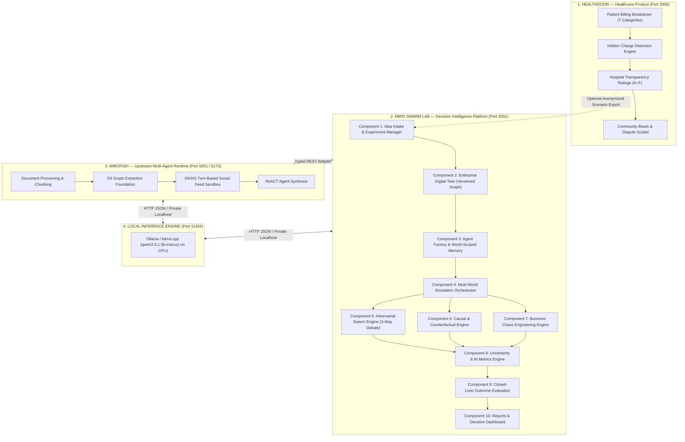

# MIRO SWARM — System Architecture & Component Specification
**Project:** Miro Swarm (Project 3 Capstone)  
**Document ID:** D02 (`MIRO_SWARM_ARCHITECTURE.md`)  
**Version:** 1.0  
**Date:** November 9, 2026  

---

## 1. High-Level Architecture Topology

Miro Swarm establishes strict, verifiable architectural boundaries across three independent services:

---

## 2. Architectural Boundary Rules

1. **Independent Operation Rule:**
   * **Healthdoor** operates independently on port `3000`. Its core patient-facing tools (bill audits, transparency scorecards) never depend on a running simulation or local LLM.
   * **Miro Swarm Lab** operates independently on port `3001`. It can ingest non-healthcare enterprise decisions (e.g., banking interest rate changes, retail supply chain disruptions) without Healthdoor installed.
   * **MiroFish** remains an independently deployable reference engine on ports `5001`/`5173`.
2. **Explicit Adapter Boundary:**
   * Miro Swarm Lab communicates with MiroFish strictly via an explicit typed HTTP REST client (`MiroFishAdapter`). MiroFish code is never imported into the Healthdoor React client.
3. **No Cross-World State Leakage:**
   * Each simulation world ($W_1, W_2, \dots, W_n$) maintains dedicated, isolated memory tables and event streams. An agent action in World A cannot mutate or influence World B.
4. **Local Hardware Budget Policy:**
   * Local inference is bound to `127.0.0.1:11434`. Memory consumption is capped below 50% total RAM (3.8 GiB) on the EC2 target.
5. **No Autonomous Production Modification:**
   * In strict accordance with capstone scope, all autonomous self-healing, automated PR creation, and production remediation features are excluded. Simulation findings remain human-reviewed decision-support artifacts.

---

## 3. Service & Port Allocations

| Service Name | Port | Host Binding | Process Manager | Primary Responsibility |
| :--- | :--- | :--- | :--- | :--- |
| **Healthdoor App** | `3000` | `0.0.0.0:3000` | PM2 (`healthdoor`) | Patient hospital bill audits, transparency scores |
| **Miro Swarm Lab** | `3001` | `0.0.0.0:3001` | PM2 (`miro-swarm`) | Decision rehearsal, digital-twin, adversarial analysis |
| **MiroFish Engine** | `5001` / `5173` | `127.0.0.1:5001` / `5173` | PM2 (`mirofish-ui`) | Upstream graph & social simulation engine |
| **Ollama Local LLM** | `11434` | `127.0.0.1:11434` | Systemd (`ollama`) | Offline CPU quantized inference (`qwen2.5:1.5b`) |
| **Persistence DB** | — | Local File | SQLite (`miro_swarm.db`)| Relational state, graph snapshots, events |
