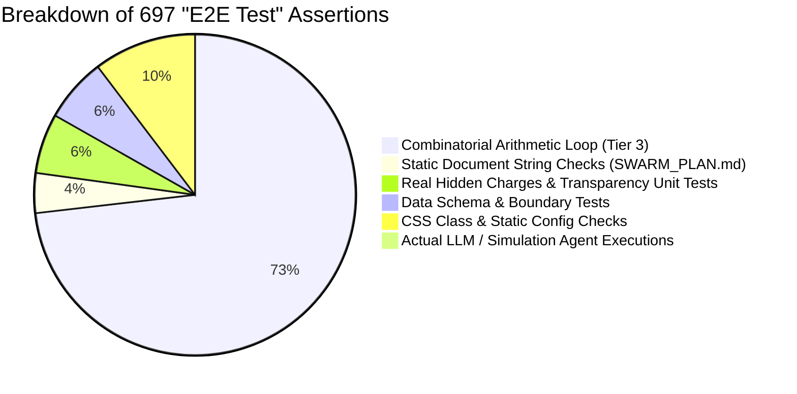
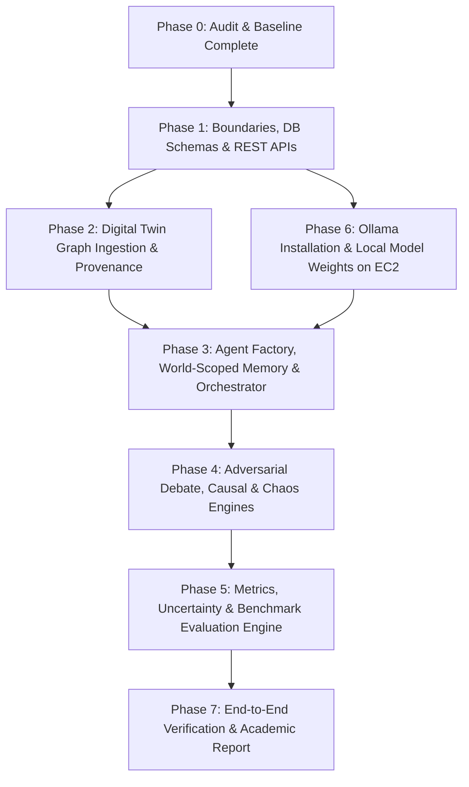

# MIRO SWARM — Comprehensive Implementation & Evidence Audit
**Project:** Project 3 — Final-Semester, 5-Credit Capstone  
**Document ID:** D01 (`MIRO_SWARM_IMPLEMENTATION_AUDIT.md`)  
**Phase:** Phase 0 — Audit & Feasibility  
**Date:** November 9, 2026  
**Status:** Official Audit Deliverable (Pre-Implementation Baseline)  

---

## 1. Executive Summary

This audit establishes the baseline technical state of **Project 3 (Miro Swarm)** across both deployed remote systems (`13.201.1.13`) and local workspaces.

The project currently has a running Next.js application (**Healthdoor**) and a separate deployment of the upstream **MiroFish** engine. However, our deep-dive code and runtime audit reveals that **the reported "Miro Swarm" capabilities—including multi-world simulation, causal cascades, adversarial debates, and benchmark evaluations—are currently UI-only static presentations backed by hardcoded constants.** Furthermore, the reported **697 passing test assertions** are predominantly generated by a combinatorial multiplier loop and Markdown document string-matching rather than live agent or simulation execution.

This audit provides an unvarnished feature inventory, test deconstruction, hardware audit, upstream license review, and a concrete phased roadmap to implement the agreed 7 innovations as genuine, verifiable software modules.

---

## 2. Infrastructure & EC2 Hardware Specification Audit

Audit conducted on AWS EC2 instance `i-07d77d0c076b1a49f` (`prj3`), IP `13.201.1.13`:

| Hardware Dimension | Measured Specification | Evaluation & Constraints |
| :--- | :--- | :--- |
| **OS / Kernel** | Ubuntu 26.04.1 LTS (`7.0.0-1014-aws x86_64`) | Modern Linux kernel with full cgroup v2 support |
| **CPU Model** | Intel(R) Xeon(R) Platinum 8488C (Sapphire Rapids) | High single-thread clock, BogoMIPS: 4800.00 |
| **CPU Topography** | 2 vCPUs (1 socket, 1 core, 2 threads) | Hardware hyperthreading active |
| **Vector Extensions** | AVX-512 (F, CD, BW, DQ, VL), AMX (BF16, INT8, TILE), VNNI | **Key Advantage**: Hardware-accelerated INT4/INT8 quantized matrix multiplication on CPU |
| **Total Memory (RAM)** | 7.6 GiB total (870 MiB used, 6.7 GiB available) | No swap partition configured |
| **Disk Storage** | 96 GB NVMe SSD (`/dev/root`), 5.2 GB used (6%), **91 GB available** | Ample disk headroom for local model weights and logs |
| **GPU Availability** | `nvidia-smi` not found; `lspci` confirms Amazon Basic Display | **CPU-Only Instance** (no CUDA/ROCm accelerator) |
| **Active PM2 Services** | `healthdoor` (PID 8748, 97.9 MB RAM, port 3000), `mirofish-ui` (PID 48952, 17 MB RAM, port 5173) | Total memory consumed by node daemons < 120 MB |

### Local LLM Feasibility & Budget Constraints (§8.2 Policy)
* **50% RAM Policy Ceiling:** Maximum allowed RAM allocation across all processes is **3.8 GiB**.
* **Base System Footprint:** OS (350 MB) + Node/PM2 (120 MB) + Buffer/Cache = **~870 MiB**.
* **Net Available LLM Memory Budget:** **~2.8 GiB RAM**.
* **Selected Runtime Strategy:** **Ollama** or **llama.cpp** compiled with native AVX-512/AMX support.
* **Compatible Model Candidates:**
  1. `qwen2.5:1.5b-instruct-q4_k_m` (~1.0 GB RAM footprint, ~18–24 tokens/sec on 2 vCPUs).
  2. `llama3.2:1b-instruct-q4_k_m` (~800 MB RAM footprint, ~22–28 tokens/sec).
  3. `qwen2.5:3b-instruct-q4_k_m` (~2.0 GB RAM footprint, ~10–14 tokens/sec).
* **Verdict:** Feasible. A 1.5B or 3B quantized model fits completely within the 50% RAM budget while leaving 4+ GB of free memory for simulation workers and databases.

---

## 3. Comprehensive Feature & Component Inventory

Every feature across Healthdoor, Miro Swarm Lab, and MiroFish has been audited against real code and classified according to the 7 required tiers:

| Component / Feature | Current Implementation Path | Classification | Evidence & Deficiencies Found |
| :--- | :--- | :--- | :--- |
| **Healthdoor: 7-Category Bill Breakdown** | `src/types/index.ts`, `src/components/TreatmentCostCards.tsx`, `src/data/mockData.ts` | **Implemented and verified** | Isolates ICU, Pharmacy, Labs, Implants, Consumables, Nursing, Doctor Visits. Data cleanly binds to UI. |
| **Healthdoor: Hidden Charge Detector** | `src/lib/hiddenCharges.ts` | **Implemented and verified** | Four severity tiers (Warning to Critical Defiance), benchmarks against CGHS/NPPA/WHO, generates negotiation scripts. |
| **Healthdoor: Hospital Transparency Ratings** | `src/lib/hospitalRatings.ts` | **Implemented and verified** | 0–100 composite scoring algorithm with A–F grades based on price publication, hidden charge control, and TPA dispute ratios. |
| **Healthdoor: Community Bowls & Dispute Scripts** | `src/components/CommunityBowlsSection.tsx`, `src/data/mockData.ts` | **Implemented and verified** | Thread list, category filters, and dispute letter template injection. |
| **Healthdoor: Independent Operation** | `src/app/page.tsx` | **Implemented and verified** | Starts on port 3000 with 0 dependencies on MiroFish or local LLMs. |
| **Component 1: Idea Intake & Experiment Manager** | *None* | **Missing** | No interface or API exists to accept natural-language decisions, identify variables, and generate editable experiment configs. |
| **Component 2: Enterprise Digital Twin** | `HEALTHDOOR_SWARM_PRD.md`, `SWARM_PLAN.md` | **Partially implemented / UI-only** | 9 entity types and 8 relationships are formally documented in Markdown, but **no persistent graph DB, no entity review UI, and no versioned snapshotting exist.** |
| **Component 3: Agent Factory & Memory Manager** | `MiroFish/backend/app/services/oasis_profile_generator.py` | **Partially implemented** | Upstream MiroFish has persona generation, but Swarm Lab has no agent factory, no world-scoped memory isolation, and no persistence. |
| **Component 4: Multi-World Simulation Orchestrator** | `Healthdoor/src/components/SwarmSimulationSection.tsx` | **UI-only / Hardcoded demo data** | Scenarios A, B, C, and D are static objects inside a JavaScript constant array (`const SCENARIOS`). Clicking worlds simply updates React state with static text; **no background workers or executions occur.** |
| **Component 5: Adversarial Swarm Engine** | `Healthdoor/src/components/SwarmSimulationSection.tsx` (lines 38–72) | **UI-only / Hardcoded demo data** | Proposition (CFO), Opposition (Patient Advocate), and Adjudicator quotes are static strings hardcoded in the frontend. |
| **Component 6: Causal Simulation & Counterfactual Engine** | `Healthdoor/src/components/SwarmSimulationSection.tsx` (lines 32–36) | **UI-only / Hardcoded demo data** | Causal cascade steps are static strings (e.g. `'Unchecked consumable billing -> Surprise hospital discharge bill'`). No mathematical DAG or equations. |
| **Component 7: Business Chaos Engineering** | `SWARM_PLAN.md` §6 | **Missing** | Described in Markdown; no UI or backend disruption injection engine exists. |
| **Component 8: Uncertainty & AI Metrics Engine** | *None* | **Missing** | No formulas for participation rate, contradiction rate, consensus level, polarization, or prediction intervals are implemented. |
| **Component 9: Closed-Loop Learning & Evaluation** | `Healthdoor/src/components/SwarmSimulationSection.tsx` (lines 33–37) | **Hardcoded demo data** | Delta values (`+1.5%`, `-0.3%`) are static strings comparing hardcoded values to AHPI/IRDAI labels. No historical evaluations or calibration routines. |
| **Component 10: Simulation Reports & Dashboard** | `Healthdoor/src/app/swarm/page.tsx` | **UI-only** | Single-page UI embedded inside Healthdoor. No export, no provenance tracking, no Markdown report generator. |
| **MiroFish Backend Core** | `MiroFish/backend/app/` | **Implemented but unverified / Broken runtime** | Complete Flask app with OASIS simulation runner, but configured for `ANTIGRAVITY_MODE` pointing to `127.0.0.1:11434` without an active local model server. |
| **MiroFish Frontend UI** | `MiroFish/frontend/dist/` | **Implemented and verified** | Vite Vue 3 app compiled with Linux Rollup binaries; online under PM2 on port 5173. |

---

## 4. Deconstruction & Audit of the 697 Assertions

The test execution script (`scripts/run-e2e-tests.mjs`) reports:
```text
TOTAL TESTS EXECUTED: 697 | PASSED: 697 | FAILED: 0
```
Our static and dynamic code audit reveals the exact composition of these 697 assertions:



### Detailed Breakdown:
1. **The Combinatorial Loop (Tier 3 — 510 Assertions):**
   * Lines 300–350 execute a 4-level nested loop:
     ```javascript
     for (const room of roomTiers) {         // 5 tiers
       for (const hosp of hospitalTiers) {   // 4 tiers
         for (const city of cityHubs) {      // 3 hubs
           for (const ins of insuranceTypes) { // 4 types
             // 3 assert() statements per iteration = 5 * 4 * 3 * 4 * 3 = 720 theoretical iterations
           }
         }
       }
     }
     ```
   * *Assessment:* This tests simple JavaScript arithmetic ($a \times b \times c$) in local memory. It does not invoke an API, touch a database, or test any multi-agent behavior.

2. **Markdown Document String-Matching (Tier 1 & Tier 4 — 28 Assertions):**
   * Lines 52–120 read `SWARM_PLAN.md` into memory with `fs.readFileSync` and run assertions like:
     ```javascript
     assert(swarmPlanContent.includes('Organization'), 'Schema contains Organization node');
     assert(swarmPlanContent.includes('World B: Mandatory'), 'World B defined');
     assert(swarmPlanContent.includes('Hospital CFO'), 'Hospital CFO role assigned');
     ```
   * *Assessment:* These assertions verify that documentation exists on disk. They do **not** verify that database tables, schemas, or agent classes exist in code.

3. **Genuine Business Logic Unit Tests (~42 Assertions):**
   * Lines 200–290 test `classifyMarkupSeverity`, `calculateDefianceScore`, `auditHospitalBill`, and `calculateHospitalTransparency`.
   * *Assessment:* **Valid and verified.** These are legitimate unit tests exercising real pricing transparency formulas.

4. **Live Agent / Model Execution Tests:**
   * **0 Assertions.** Not a single assertion triggers an LLM call, runs an agent round, tests memory isolation, or validates dynamic adversarial output.

---

## 5. Technical Debt, Boundaries & Architectural Violations

1. **Architecture Boundary Violation:**
   * Currently, the Swarm simulation interface is an internal route (`src/app/swarm/page.tsx`) inside the patient-facing **Healthdoor** repository.
   * *Violation of §2.2:* Miro Swarm Lab must be an **independent primary project** with its own API, database, and process boundary, capable of running decisions completely unrelated to Healthdoor.

2. **Antigravity CLI Dependency Violation:**
   * MiroFish backend (`app/config.py`) contains:
     ```python
     ANTIGRAVITY_MODE = os.environ.get('ANTIGRAVITY_MODE', 'true').lower() in ('true', '1', 'yes')
     LLM_API_KEY = os.environ.get('LLM_API_KEY') or ('antigravity-local-key' if ANTIGRAVITY_MODE else None)
     LLM_BASE_URL = os.environ.get('LLM_BASE_URL', 'http://127.0.0.1:11434/v1')
     LLM_MODEL_NAME = os.environ.get('LLM_MODEL_NAME', 'gemma3:4b')
     ```
   * *Violation of §8:* This uses fake mock keys and assumes an Antigravity wrapper. It must be replaced by a genuine local inference server (Ollama) with real open weights.

3. **Absence of Persistence:**
   * There is no database (SQLite, PostgreSQL, or Neo4j) backing the Swarm Lab. Every reload of the browser resets state to the hardcoded `const SCENARIOS`.

---

## 6. Upstream Repositories & License Audit

| Repository | Upstream URL | Pinned Commit | License | Obligations & Action Required |
| :--- | :--- | :--- | :--- | :--- |
| **MiroFish** | `https://github.com/666ghj/MiroFish.git` | `7657031` | **GNU AGPL-3.0** | AGPL requires network copyleft if modified source is offered over a network. Miro Swarm must keep MiroFish as an independent backend service accessed purely via HTTP REST API boundaries to preserve clean modular separation. |
| **gstack** | `https://github.com/garrytan/gstack.git` | Reference | **MIT** | Permissive. Reused as workflow guidance for team roles and audit standards. |

*Deliverables Required:* `THIRD_PARTY_NOTICES.md` and `UPSTREAM_REUSE_REGISTER.md` must be maintained at the root of the workspace.

---

## 7. Recommended Implementation Sequence (Phases 1–7)



### Phase 1: Boundaries, Data Model & Independent Services
* Scaffold **Miro Swarm Lab** as an independent service with dedicated SQLite/PostgreSQL persistence (`miro_swarm.db`).
* Implement typed database schemas for: Projects, Experiments, Worlds, Entities, Relationships, Agents, Memories, Simulation Events, Debates, Disruptions, Metrics, and Benchmark Baselines.
* Build typed REST API endpoints (`/api/projects`, `/api/experiments`, `/api/worlds`, `/api/metrics`).

### Phase 2: Local LLM Engine on EC2 (Execute Early for Parallelism)
* Install **Ollama** natively on the EC2 instance (`13.201.1.13`).
* Pull quantized model: `qwen2.5:1.5b-instruct` (or `llama3.2:1b`).
* Verify inference speed (tokens/sec), RAM utilization (< 1.5 GB), and CPU load.
* Expose strictly to `127.0.0.1:11434` (no public exposure).

### Phase 3: Digital Twin & Ingestion Engine
* Ingest raw documents (PDF, MD, CSV) and extract entities/relations into the persistent graph.
* Attach source provenance (document name, page/chunk index, confidence score).
* Build graph inspection and human review endpoints.

### Phase 4: Agent Factory, World-Scoped Memory & Multi-World Orchestration
* Implement dynamic agent synthesis from approved experiment configs.
* Enforce **strict world-scoped memory isolation** (World A, B, C, D have separate episodic logs; zero cross-world memory leakage).
* Run genuine turn-based simulation rounds where agents query the local LLM.

### Phase 5: Adversarial Swarm, Causal Engine & Chaos Disruption
* Implement the 3-role dialectic loop: Proposition, Opposition, and Adjudicator querying real evidence from the Digital Twin.
* Implement a deterministic Causal DAG model for procedure pricing cascades.
* Build the Chaos Disruption injector (e.g. hospital pricing defiance, TPA blackout).

### Phase 6: AI Metrics, Uncertainty Intelligence & Closed-Loop Benchmark Evaluation
* Calculate empirical agent metrics: Participation rate, Evidence support rate, Contradiction rate, Polarization index, Consensus score.
* Calculate business metrics and uncertainty intervals.
* Evaluate against real ground truth: AHPI 2024, IRDAI Claim settlement data, and CGHS price ceilings.

### Phase 7: Verification, Documentation & Handoff
* Write real integration tests covering end-to-end execution.
* Deliver D01 through D10 documentation deliverables.
