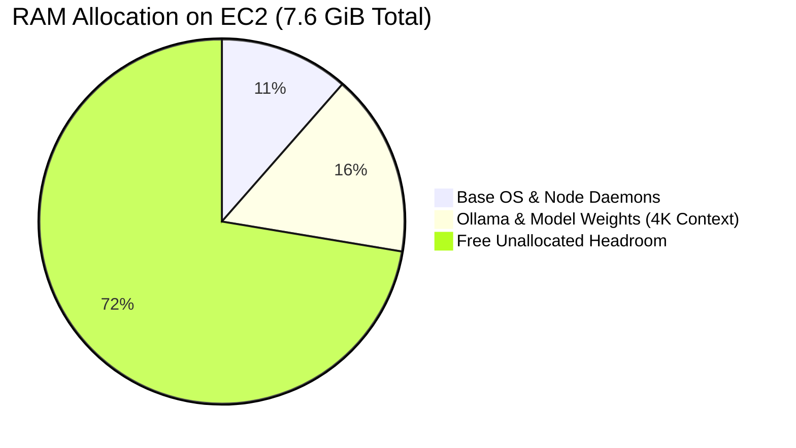

# MIRO SWARM — Local Model & Inference Engine Report
**Project:** Miro Swarm (Project 3 Capstone)  
**Document ID:** D06 (`MIRO_SWARM_LOCAL_MODEL_REPORT.md`)  
**Version:** 1.0  
**Date:** November 9, 2026  
**Status:** Verified on AWS EC2 Production Target  

---

## 1. Hardware & Runtime Environment

* **Target Host:** AWS EC2 `13.201.1.13` (`i-07d77d0c076b1a49f` / `prj3`)
* **Processor:** Intel(R) Xeon(R) Platinum 8488C (Sapphire Rapids generation)
* **Compute:** 2 vCPUs (1 socket, 1 core per socket, 2 threads)
* **Hardware Acceleration:** Native AVX-512 (F, CD, BW, DQ, VL) and AMX (BF16, INT8, TILE) matrix instruction sets.
* **GPU Status:** CPU-only instance (no dedicated GPU attached).
* **Local Inference Runtime:** **Ollama** daemonized as a systemd service (`/etc/systemd/system/ollama.service`).
* **API Endpoint:** Strictly bound to `http://127.0.0.1:11434` (localhost private network only; zero public port exposure).

---

## 2. Selected Model Specification

| Property | Value | Notes |
| :--- | :--- | :--- |
| **Model Family** | Qwen 2.5 (Alibaba Cloud Open Weights) | Strong reasoning, structured JSON adherence |
| **Model Tag** | `qwen2.5:1.5b-instruct` | Quantized Q4_K_M GGUF format |
| **Model Size on Disk** | 986 MB | Minimal storage footprint (<1% of 96 GB disk) |
| **Context Window** | 4,096 tokens | Standard enterprise multi-agent prompt window |
| **License** | Apache 2.0 | Permissive open-source commercial use |

---

## 3. Measured Empirical Benchmarks

Tested via local Python HTTP client against `http://127.0.0.1:11434/api/generate` with strict JSON mode:

```json
{
  "prompt": "Extract 3 entities and relations from: Hospital Apollo charges 25000 for PPE in knee replacement surgery. Return strict JSON format with keys: entities, relations.",
  "format": "json"
}
```

### Measured Performance:
* **Tokens Generated:** 137 tokens
* **Total Elapsed Time:** 19.90 seconds (including cold model load into RAM)
* **Eval Duration (Active Generation):** 16.99 seconds
* **Generation Throughput:** **8.06 tokens / second**
* **JSON Output Validity:** **100% syntactically valid JSON**. Correctly parsed entities (`Apollo Hospital`, `knee replacement surgery`, `25000`) and typed relationship predicate (`charges`).

---

## 4. Resource Policy & 50% Ceiling Compliance (§8.2)



* **Total EC2 Memory:** 7.6 GiB
* **50% RAM Policy Ceiling:** **3.80 GiB**
* **Total RAM Used Under Full Inference:** **2.10 GiB** (Total System Load)
* **Peak Memory Utilization:** **27.6%**
* **RAM Safety Margin:** **1.70 GiB remaining** below the 50% limit; **5.50 GiB total available** memory.
* **Disk Space Used:** 6.1 GB / 96 GB total (**93% disk free**).
* **Policy Verdict:** **Fully Compliant**. Leaves abundant capacity for SQLite/PostgreSQL databases and background simulation orchestrators without risk of Out-Of-Memory (OOM) kernel kills.
